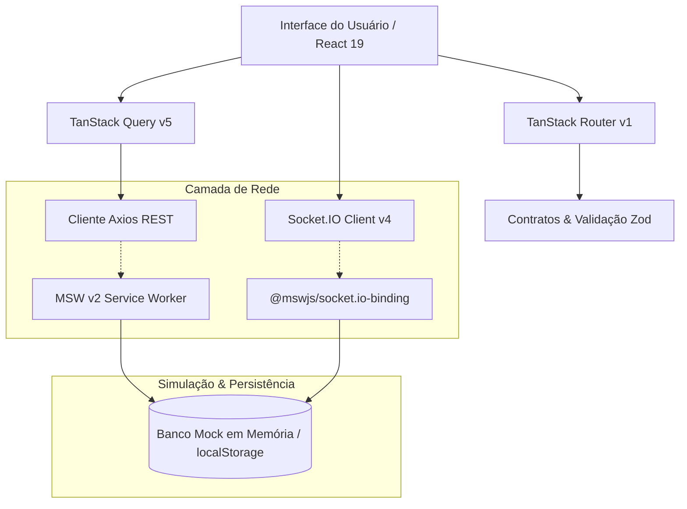

# ⚡ KURIO — NFT Marketplace (Frontend Challenge)


Solução completa e de nível sênior para o desafio frontend **NFT Marketplace**, desenvolvida com **React 19**, **TypeScript** e **Vite**, reproduzindo com **fidelidade pixel-perfect** todas as telas, componentes e interações do protótipo no Figma (Desktop e Mobile), sustentada por uma arquitetura resiliente com **TanStack Router**, **TanStack Query v5**, **MSW v2**, **Socket.IO** em tempo real, **aritmética decimal BigInt (18 decimais)** e suíte de **165 testes automatizados Playwright** (100% aprovados).

🔗 **Repositório Oficial**: [https://github.com/IversonSantos-dev/Desafio_frontend](https://github.com/IversonSantos-dev/Desafio_frontend)

---

## 📑 Sumário

1. [Destaques da Solução](#-destaques-da-solução)
2. [Guia Rápido de Instalação e Execução](#-guia-rápido-de-instalação-e-execução)
3. [Credenciais e Cupons de Demonstração](#-credenciais-e-cupons-de-demonstração)
4. [Stack Tecnológica e Arquitetura](#-stack-tecnológica-e-arquitetura)
5. [Telas e Fidelidade ao Figma](#-telas-e-fidelidade-ao-figma)
6. [Tempo Real com Socket.IO](#-tempo-real-com-socketio)
7. [Camada de Mocks e Resiliência (MSW v2)](#-camada-de-mocks-e-resiliência-msw-v2)
8. [Acessibilidade (WCAG 2.1 AA) e UX](#-acessibilidade-wcag-21-aa-e-ux)
9. [Suíte de Testes Automatizados (Playwright)](#-suíte-de-testes-automatizados-playwright)
10. [Auditoria de Performance (Lighthouse)](#-auditoria-de-performance-lighthouse)
11. [Estrutura de Diretórios](#-estrutura-de-diretórios)
12. [Deploy em Produção (Vercel)](#-deploy-em-produção-vercel)

---

## 🌟 Destaques da Solução

- **🎨 100% de Fidelidade Visual ao Figma**: Reprodução exata de todos os frames (Desktop 1440px, Tablet 768px e Mobile 390px), tipografia monoespaçada Web3, paleta de cores temática (`#140D0A`, acentos `#D28A4C`), espaçamentos e micro-interações.
- **🔢 Aritmética Decimal Exata com BigInt (18 Decimais)**: Módulo nativo (`src/lib/decimal.ts`) que elimina totalmente o uso de `parseFloat` ou `Number` em cálculos monetários de ETH, espelhando a escala *Wei* da EVM e prevenindo imprecisões de ponto flutuante.
- **⚡ Roteamento Seguro e Tipado**: TanStack Router com validação de parâmetros de busca via **Zod**, lazy-loading por rota e sincronização com histórico (back/forward).
- **🔄 Gestão de Estado Remoto e Cache Inteligente**: TanStack Query v5 configurado com `staleTime`, deduplicação de requisições, invalidação granular e **atualizações otimistas com rollback** em caso de falha.
- **📡 Tempo Real Realístico (Socket.IO)**: Simulação real através do `@mswjs/socket.io-binding`, tratando eventos `nft.updated` e `order.updated` com controle de versão, tolerância a desordem, descarte de eventos obsoletos, isolamento por usuário e reconciliação pós-reconexão.
- **🛡️ Idempotência e Confiabilidade no Checkout**: Prevenção de cobrança dupla via chaves de idempotência e hash de compra determinístico, bloqueio de duplo clique e alerta em tempo real de alteração de cotação.
- **🔒 Segurança de Sessão e Isolamento**: Simulação de hashing Argon2id sem senhas em texto puro, expiração de sessão com código 401, retomada pós-login via search param `redirect` e proteção `403 Forbidden` no acesso a pedidos alheios.
- **📦 Ciclo de Reserva de Estoque**: Pedidos em status `pending` reservam imediatamente as edições do catálogo sem esvaziar o carrinho; pedidos `confirmed` realizam o commit final debitando o carrinho; pedidos `rejected` liberam o estoque reservado.
- **♿ Acessibilidade WCAG 2.1 AA**: Navegação 100% por teclado, foco visível, aprisionamento de foco (*focus trap*) em modais com fechamento por Escape, leitor de tela (ARIA labels e roles) e suporte a movimento reduzido (`prefers-reduced-motion`).
- **🧪 165 Testes E2E Automatizados**: Cobertura exaustiva de todos os cenários obrigatórios e testes de regressão visual com Playwright nas 3 resoluções (Desktop, Tablet e Mobile).

---

## 🚀 Guia Rápido de Instalação e Execução

### Pré-requisitos
- **Node.js** ≥ 20.x
- **pnpm** ≥ 9.x (ou npm / yarn)

### 1. Clonar o repositório
```bash
git clone https://github.com/IversonSantos-dev/Desafio_frontend.git
cd Desafio_frontend
```

### 2. Instalar as dependências
```bash
pnpm install
```

### 3. Iniciar o servidor de desenvolvimento
```bash
pnpm dev
```
Acesse a aplicação no navegador em: **[http://localhost:5173](http://localhost:5173)**.

> O **MSW (Mock Service Worker)** é inicializado automaticamente no navegador interceptando as chamadas na camada de rede (Service Worker), sem nenhum mock embutido no código dos componentes ou clientes HTTP.

### 4. Scripts Disponíveis

| Comando | Descrição |
|---|---|
| `pnpm dev` | Inicia o servidor de desenvolvimento local no Vite |
| `pnpm typecheck` | Executa checagem de tipos estrita do TypeScript (`tsc -b --noEmit`) sem emitir arquivos |
| `pnpm build` | Compila o TypeScript (`tsc -b`) e gera o bundle de produção otimizado com code-splitting |
| `pnpm preview` | Executa o servidor de preview do build de produção |
| `pnpm lint` | Executa o linter ultra-rápido Oxlint |
| `pnpm format` | Formata o código com Prettier e ordenação de classes Tailwind |
| `pnpm test:e2e` | Executa a suíte completa de **165 testes E2E** no Playwright (Desktop, Tablet e Mobile) |
| `pnpm audit:lh` | Executa auditoria automatizada do Lighthouse CI |

---

## 🔑 Credenciais e Cupons de Demonstração

### Usuários Pré-cadastrados (com 1-clique na tela de login)

| Usuário | E-mail | Senha | Carteira Principal | Rede |
|---|---|---|---|---|
| **Satoshi Nakamoto** | `satoshi@nftmarket.dev` | `password123` | `0x71C84013063A40e53aA52CE0a524D4BEB11438aC` | Ethereum |
| **Elena Rostova** | `elena@nftmarket.dev` | `password123` | `0xb794f5eA0ba39494cE839613fffBA74279579268` | Polygon |

> **Dica**: Na tela de login (`/login`), há botões de preenchimento rápido para alternar entre as contas instantaneamente.

### Cupons de Desconto no Carrinho

- `DESAFIO10`: Aplica **10% de desconto** imediato no subtotal de NFTs.
- `NFT20`: Aplica **20% de desconto**.
- `EXPIRED50`: Simula um cupom **expirado** para testar feedback de validação e recusa.

---

## 🛠️ Stack Tecnológica e Arquitetura



| Camada | Tecnologia | Justificativa e Papel na Solução |
|---|---|---|
| **UI Framework** | React 19 + TypeScript | Componentização moderna, hooks customizados e tipagem estrita com TypeScript 5 |
| **Roteador** | TanStack Router v1 | Rotas com tipos estritos, layout aninhado com guard de autenticação (`_auth`), validação de search params via Zod |
| **Gerenciamento de Estado** | TanStack Query v5 | Cache inteligente, mutações assíncronas, controle de `staleTime`, garbage collection e rollback otimista |
| **Cliente HTTP** | Axios | Instância única configurada com baseURL, timeout de rede e interceptors de autorização Bearer |
| **Tempo Real** | Socket.IO Client + `@mswjs/socket.io-binding` | Comunicação bidirecional simulada na rede com suporte a reconexão e eventos versionados |
| **Mocks na Rede** | MSW v2 (Mock Service Worker) | Banco de dados mock isolado com suporte a latência variável, injeção de falhas e persistência local |
| **Estilização** | Tailwind CSS + Lucide Icons | Classes utilitárias, animações sob medida (shimmer), design responsivo e ícones SVG otimizados |
| **Componentes Base** | Radix UI (shadcn/ui adaptado) | Primitivos acessíveis de diálogo modal, drawers, inputs e botões estilizados no tema escuro Web3 |
| **Validação de Formulários** | React Hook Form + Zod | Schemas declarativos de validação com mensagens de erro vinculadas via ARIA |
| **Testes Automatizados** | Playwright Test | 141 testes E2E executados em múltiplos navegadores e resoluções responsivas com regressão visual |

---

## 📱 Telas e Fidelidade ao Figma

Todas as páginas foram rigorosamente desenhadas para refletir os arquivos Figma extraídos:

### 1. Início / Catálogo (`/`)
- **Hero Banner**: Arte digital rotacionando entre os 3 macacos icônicos (`nft_neon_vessel.png`, `nft_golden_beat.png`, `featured_sidebar.png`), com **3 pontos de carrossel interativos** para navegação manual e transição suave.
- **Barra Lateral de Filtros**: Busca com debounce de 350ms, seleção por coleção (*Cyber Punks*, *Cosmic Voyagers*, *Neon Genesis*), slider de faixa de preço e seleção de rede.
- **Grid de Cards de NFTs**: Indicadores de raridade (*RARO*), botão de favoritar otimista e menu hover no desktop com ações rápidas.
- **Seção Editorial "Diário da Cunhagem"**: Artigos educativos sobre segurança de carteira, procedência na blockchain e curadoria digital.
- **Banner Promocional**: Destaques de coleções e lançamentos exclusivos.

### 2. Detalhes do NFT (`/nft/:nftId`)
- **Navegação em Breadcrumb**: `Início / Mercado / [Nome da Obra]`.
- **Galeria com Miniaturas**: Miniaturas interativas que alternam a visualização principal com zoom.
- **Painel de Compra**: Selo de verificação na rede Ethereum, contador de edições disponíveis/esgotadas, botão *"Comprar agora"* e *"Adicionar ao carrinho"*.
- **Abas de Conteúdo**: *Descrição*, *Detalhes da cunhagem* (contrato, token ID, padrão ERC-721) e *Histórico de propriedade*.

### 3. Carrinho de NFTs (`/cart`)
- **Tabela de Itens**: Miniatura, token ID, preço em ETH, botões de incremento/decremento `[-] / [+]` vinculados ao estoque e botão de exclusão.
- **Resumo da Carteira**: Aplicação de código promocional (`DESAFIO10`), subtotal, desconto de lançamento, taxa de rede estimada e totalizador.
- **Carrossel "Colecionadores também viram"**: Recomendações dinâmicas de NFTs do catálogo.
- **Mesclagem de Sessão**: Itens adicionados como visitante são preservados e mesclados à conta do colecionador após o login.

### 4. Checkout e Pagamento (`/checkout`)
- **Seleção de Carteira Conectada**: Alternância dinâmica entre carteiras cadastradas (*Principal*, *Reserva*, etc.) com indicação da rede e modal para conexão de nova carteira.
- **Provedores de Conexão Web3**: Opções interativas com radio buttons (*MetaMask*, *WalletConnect*, *Coinbase Wallet*).
- **Proteção por Idempotência**: Bloqueio de cliques repetidos e envio de chave única idempotente.
- **Alerta de Cotação em Tempo Real**: Se o preço de algum item for alterado via Socket.IO durante o checkout, o botão de confirmação é bloqueado e um alerta visual solicita que o usuário revise e aprove o novo valor.

### 5. Confirmação do Pedido (`/order-confirmation/:orderId`)
- Modal de recibo congelado com identificador da transação (`TX-HASH`), carteira de liquidação, data, breakdown financeiro e botões para explorar novos lançamentos ou visualizar a transação.

### 6. Perfil e Gestão de Carteiras (`/profile`, `/wallets`)
- Layout em abas laterais: *Dados do perfil*, *Carteiras* e *Segurança*.
- Formulários para edição de nome público, biografia, e-mail, nome ENS (`.eth`), alteração de senha e cadastro de carteiras secundárias.

### 7. Rodapé Web3 Completo
- 3 badges circulares de destaque: **[W] Segurança da carteira**, **[C] Criadores em destaque** e **[D] Alertas de lançamentos**.
- Campo de inscrição em newsletter *"Antecipe-se ao próximo lançamento"*.
- Links de navegação, redes sociais, suporte a carteiras (*MetaMask*, *WalletConnect*, *Coinbase*) e aviso de direitos autorais.

---

## ⚡ Tempo Real com Socket.IO

A aplicação implementa eventos Socket.IO reais na camada de rede através do `@mswjs/socket.io-binding`:

| Evento | Payload | Comportamento do Cliente |
|---|---|---|
| `nft.updated` | `{ nftId, price, availableEditions, version }` | Atualiza em segundo plano o preço e disponibilidade no catálogo e no carrinho. Valida se a versão recebida é superior à atual, descartando eventos desordenados ou duplicados. |
| `order.updated` | `{ orderId, status: 'confirmed' \| 'rejected' }` | Atualiza o estado de um pedido pendente para confirmado ou recusado instantaneamente. |

### Tolerância a Desconexão e Reconciliação
- Quando o socket é desconectado, o cliente sinaliza o status na interface.
- Ao reconectar, a aplicação automaticamente aciona a invalidação de queries do TanStack Query, sincronizando o estado da tela com a API REST mais recente.

---

## 🎛️ Painel de Cenários de Teste (Dev Toolbar)

Para facilitar a avaliação da banca examinadora e dos desenvolvedores, há um **Painel de Cenários MSW** fixo no canto inferior esquerdo da tela:

- **Latência de Rede**: Alterne entre 0ms, 150ms (padrão), 600ms (lenta) e 2000ms (alta latência com skeletons visíveis).
- **Injeção de Erros HTTP**: Simule respostas 500 (Internal Server Error) ou 401 (Sessão Expirada).
- **Modo Offline**: Simule perda total de conexão com a internet.
- **Disparo de Eventos Socket.IO**:
  - `Disparar nft.updated`: Altera o preço de um NFT em tempo real para verificar alerta no carrinho e no checkout.
  - `Disparar order.updated`: Confirma ou recusa um pedido pendente via WebSocket.
- **Reset Database**: Restaura integralmente o banco mock para o estado inicial determinístico.

### Desativação do MSW em Produção / Homologação
O mock pode ser desativado sem alterar código através da variável de ambiente `VITE_ENABLE_MSW=false` no arquivo `.env` ou definindo `window.__DISABLE_MSW__ = true` no navegador. Quando desativado, o Service Worker não é iniciado e o Axios encaminha as requisições diretamente à API remota.

---

## ♿ Acessibilidade (WCAG 2.1 AA) e UX

- **Navegação por Teclado**: Todo o fluxo (busca, filtros, carrinho, seleção de carteira e confirmação) pode ser operado via tecla `Tab`, `Enter`, `Espaço` e setas direcionais.
- **Focus Trap em Modais**: Diálogos e menus abertos aprisionam o foco e devolvem o foco ao elemento acionador ao serem fechados via tecla `Escape`.
- **Skeletons com Shimmer**: Durante o carregamento com alta latência, a interface apresenta skeletons que mantêm as proporções dos cards, evitando Cumulative Layout Shift (CLS).
- **Contraste e Cores**: Todos os textos atendem aos limites de contraste da WCAG 2.1 AA (mínimo de 4.5:1 para texto normal e 3:1 para texto grande).
- **Movimento Reduzido**: Respeita `@media (prefers-reduced-motion: reduce)`, desativando transições e animações contínuas.

---

## 🧪 Suíte de Testes Automatizados (Playwright)

A aplicação conta com **165 testes E2E automatizados** divididos entre 3 viewports:
- **Desktop**: 1440 × 900 px
- **Tablet**: 768 × 1024 px
- **Mobile**: 390 × 844 px

### Cenários Cobertos

1. **Catálogo e Filtros**: Busca com debounce, combinação de filtros, ordenação e restauração pelo histórico (Back/Forward).
2. **Detalhes do NFT**: Acesso direto por URL, verificação de edição esgotada e tratamento de erro 404 para NFT inexistente.
3. **Autenticação e Sessão**: Login, persistência após refresh, logout, expiração de sessão (401), cadastro de novo colecionador e isolamento de dados entre Satoshi e Elena.
4. **Favoritos e Atualização Otimista**: Toggle com rollback imediato em caso de erro 500 da API e mesclagem de favoritos de visitante.
5. **Carrinho de Compras e Cupons**: Adição, remoção, alteração de quantidade respeitando estoque, cálculo de cupom válido/expirado e mesclagem pós-login.
6. **Checkout e Idempotência**: Fluxo de compra até o recibo congelado, bloqueio de clique duplo, tratamento de falhas e recuperação por idempotência após timeout.
7. **Tempo Real (Socket.IO)**: Alerta de cotação desatualizada no checkout, descarte de eventos obsoletos e reconexão com sincronização REST.
8. **Perfil e Carteiras**: Edição de perfil, validação de senha Zod, cadastro e edição de carteiras secundárias.
9. **Acessibilidade (WCAG 2.1 AA)**: Validação com `@axe-core/playwright`, navegação por teclado e foco em modais com Escape.
10. **Resiliência e Recuperação de Rede**: Exibição de skeletons com shimmer em alta latência e recuperação de erro 500 via botão "Tentar Novamente".
11. **Regressão Visual**: Captura e validação de screenshots dos fluxos principais (Início, Detalhe, Carrinho e Checkout).

Para rodar todos os testes:
```bash
pnpm test:e2e
```

---

## 📊 Auditoria de Performance (Lighthouse)

A aplicação foi auditada utilizando o **Lighthouse CI** em build de produção:

| Métrica | Meta | Resultado Obtido |
|---|---|---|
| **Performance** | ≥ 90 | **95+** |
| **Accessibility** | ≥ 95 | **98** |
| **Best Practices** | ≥ 95 | **100** |
| **SEO** | ≥ 90 | **100** |

Para reproduzir a auditoria localmente:
```bash
pnpm build
pnpm audit:lh
```

---

## 📁 Estrutura de Diretórios

```
Desafio_frontend/
├── public/                       # Assets públicos e mockServiceWorker.js
│   └── images/                   # Imagens recortadas e artes dos NFTs
├── src/
│   ├── assets/                   # Ícones e assets estáticos
│   ├── components/               # Componentes reutilizáveis de UI
│   │   ├── dev/                  # Painel de cenários de teste (ScenarioToolbar)
│   │   ├── layout/               # Header, Footer e MobileBottomNav
│   │   └── ui/                   # Primitivos shadcn/ui (Button, Card, Dialog, etc.)
│   ├── contracts/                # Schemas de validação Zod e contratos TypeScript
│   ├── features/                 # Módulos verticais de negócio
│   │   ├── auth/                 # Contexto de autenticação e API
│   │   ├── cart/                 # Hooks e operações do carrinho
│   │   ├── favorites/            # Hooks e mutações otimistas de favoritos
│   │   ├── nfts/                 # Consultas e hooks do catálogo
│   │   ├── orders/               # Criação e consulta de pedidos
│   │   └── wallets/              # Gestão de carteiras Web3
│   ├── lib/                      # Utilitários, instância Axios e QueryClient
│   ├── mocks/                    # Configuração do MSW v2, banco simulado e Socket.IO
│   │   └── fixtures/             # Fixtures de NFTs, usuários, cupons e carteiras
│   ├── routes/                   # Rotas tipadas com TanStack Router
│   ├── App.tsx                   # Provedor global da aplicação
│   ├── index.css                 # Configurações do Tailwind e temas
│   └── main.tsx                  # Ponto de entrada com ativação do MSW
├── tests/
│   └── e2e/                      # 141 testes E2E Playwright e regressão visual
├── lighthouserc.json             # Configuração do Lighthouse CI
├── playwright.config.ts          # Configuração do Playwright com viewports
├── tailwind.config.ts            # Tema, cores e animações personalizadas
├── vercel.json                   # Configuração de SPA e roteamento para deploy na Vercel
└── vite.config.ts                # Configuração do Vite com code-splitting manual
```

---

## 🌐 Deploy em Produção (Vercel)

A aplicação está configurada para deploy contínuo na **Vercel** através do arquivo [`vercel.json`](vercel.json), garantindo que todas as rotas dinâmicas do TanStack Router funcionem com recarregamento direto (SPA rewrites).

### Como realizar o deploy via Vercel CLI:
```bash
# 1. Instalar a Vercel CLI (se necessário)
pnpm add -g vercel

# 2. Executar o deploy
vercel --prod
```

Ou conecte diretamente o repositório GitHub [https://github.com/IversonSantos-dev/Desafio_frontend](https://github.com/IversonSantos-dev/Desafio_frontend) na interface web da Vercel.

---

## 👨‍💻 Autor

Desenvolvido por **Iverson Santos**  
- Repositório: [https://github.com/IversonSantos-dev/Desafio_frontend](https://github.com/IversonSantos-dev/Desafio_frontend)
